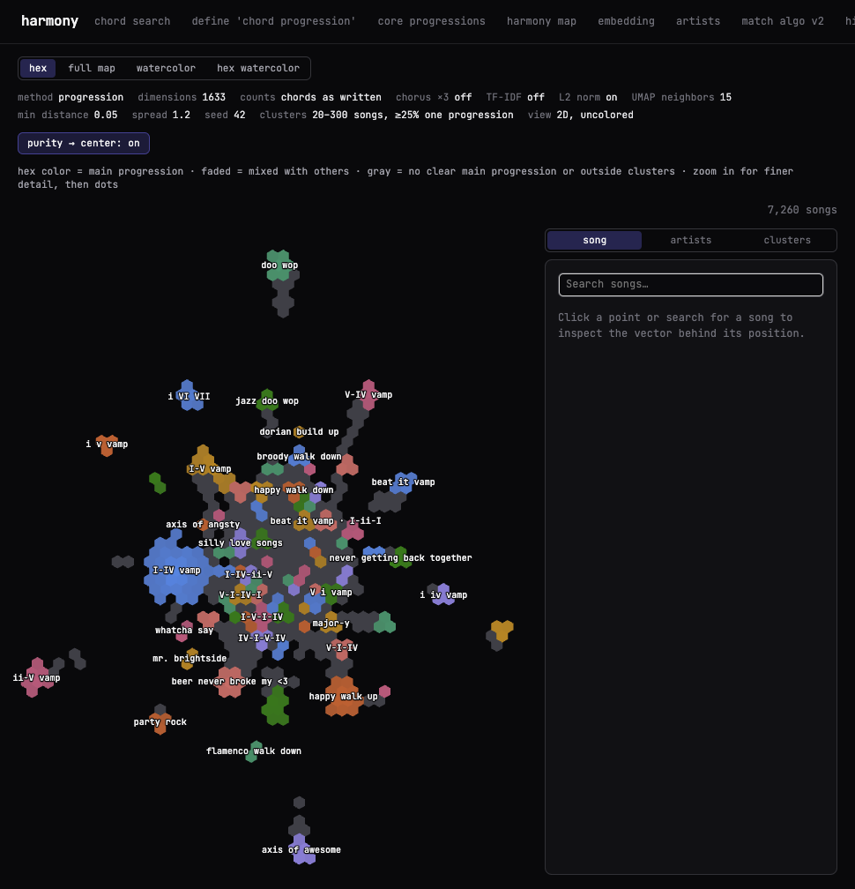
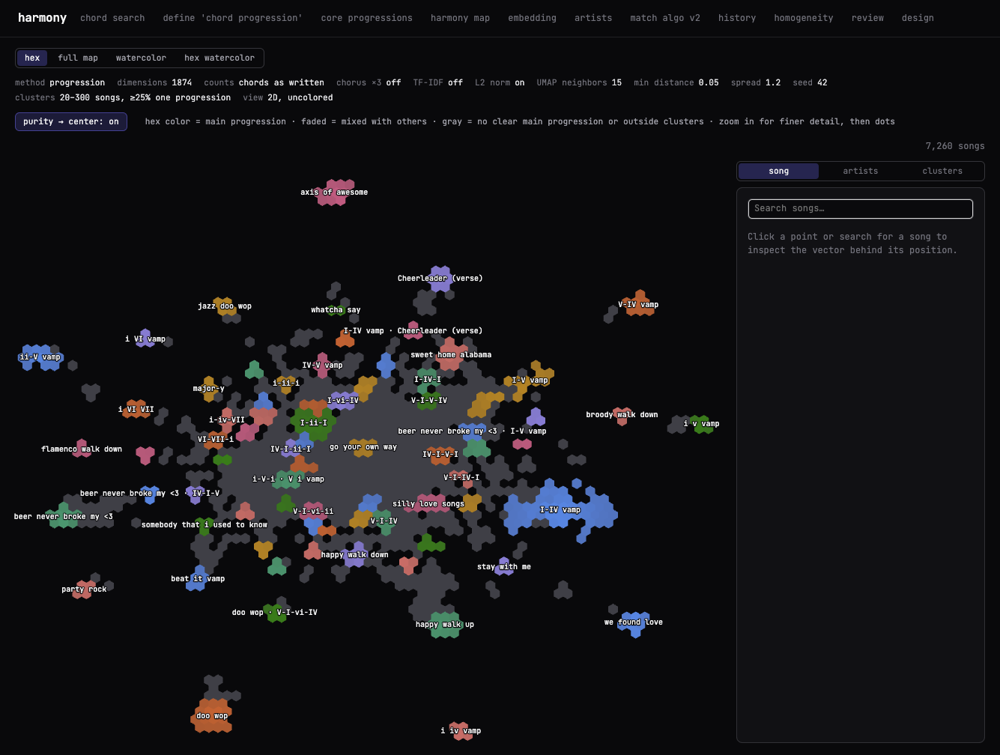

# Exact roman numeral matching: before / after

`matchSongV2` used to match progressions by interval shape only, so `vi-V-IV-I` and `i-VII-VI-III` (or `I-bVII-IV` and `V-IV-I`) were the same progression unless a core set `matchRomanNumeralsExactly`. Every match is now tonic-locked: the chords must sit on the same degrees relative to the section's tonic, with the same qualities. This applies to core lookup, repeat counting, prefix leftovers, and unifying non-core spans within a song. A section spelled in a different scale still matches if it's the same chords over the same tonic (a minor `i-VII` matches a major-labeled `i-bVII`).

Numbers come from `tasks/report-clusters.ts` (`before.json`, `after.json`). It runs the same pipeline as the hex map: `computeSongCoverage`, then `computeHexMapLayout` (seeded UMAP), then density clusters (20 to 300 songs, at least 25% sharing one main progression).

## Hex map (`/demo/embedding?map=hex`)

| Before                              | After                             |
| ----------------------------------- | --------------------------------- |
|  |  |

The overall shape survives: one central mass with vamp and doo-wop satellites. Clusters that existed only because relative-minor or mixolydian spellings were folded in shrink or disappear (beat it vamp, blues rock, V i vamp, plagal cascade, viva la vida). Clusters that used to be absorbed into a relative shape now stand on their own (stay with me, (minor)axis of awesome, I-ii-I, dangerous).

## Headline numbers

|                                      | Before |        After |
| ------------------------------------ | -----: | -----------: |
| Songs                                |  7,260 |        7,260 |
| Mean explained coverage              |  91.6% |        91.5% |
| Songs matching at least one core     |  5,769 | 5,188 (−581) |
| Named clusters                       |     85 |           72 |
| Songs inside a named cluster         |  5,136 |        4,293 |
| Songs whose main progression changed |        | 861 of 7,211 |

Coverage barely moves, because chords that no longer match a core are still explained by literal non-core progressions. What changes is which name they get.

## How many songs depend on cross-scale spelling

A core match is "cross-scale" when the section's scale differs from the core's scale, for example a minor core matched in a major-labeled section.

|                              | Songs | Matches |
| ---------------------------- | ----: | ------: |
| Before (relative matching)   | 1,169 |   1,458 |
| After (exact roman numerals) |   178 |     207 |

Before, most of these were relative-key collisions: `beat it vamp` (minor core, major section) 204, `we found love` 122, `somebody that i used to know` 99, `IV-V vamp` (major core, minor section) 76, `plagal cascade` 66, `V i vamp` 56. Exact matching removes them.

**If we also required the scale to match**, the remaining 178 songs (207 matches) would lose those matches. These are the same chords over the same tonic, just labeled in a different mode. The most affected:

| Core (core scale, section scale)           | Songs |
| ------------------------------------------ | ----: |
| I-IV vamp (major, mixolydian)              |    14 |
| I-IV vamp (major, minor)                   |    12 |
| jazz ii-V-I (major, minor)                 |    11 |
| I-V vamp (major, minor)                    |    10 |
| V i vamp (minor, major)                    |     8 |
| blues rock (major, minor)                  |     7 |
| i iv vamp (minor, major)                   |     6 |
| broody walk down (minor, harmonicMinor)    |     6 |
| V i vamp (minor, harmonicMinor)            |     6 |
| beer never broke my <3 (major, mixolydian) |     5 |
| happy walk up (major, minor)               |     5 |
| beat it vamp (minor, dorian)               |     5 |
| happy walk up (major, mixolydian)          |     5 |
| Cheerleader (verse) (major, mixolydian)    |     5 |

The full list is in `after.json` under `crossScale.byCore`. Many of these involve modal sections (mixolydian, dorian, harmonic minor), where a strict major/minor scale check would be too blunt. Keeping the pitch-based rule looks right.

## Per-core song counts

Biggest losses:

| Core                         | Before | After | Change |
| ---------------------------- | -----: | ----: | -----: |
| beat it vamp                 |    336 |   119 |   −217 |
| sweet home alabama           |    693 |   496 |   −197 |
| IV-V vamp                    |    451 |   279 |   −172 |
| blues rock                   |    185 |    53 |   −132 |
| we found love                |    222 |   103 |   −119 |
| V-IV vamp                    |    365 |   256 |   −109 |
| ii-V vamp                    |    283 |   179 |   −104 |
| somebody that i used to know |    179 |    82 |    −97 |
| jazz changes (dominant-y)    |    137 |    56 |    −81 |
| plagal cascade               |     79 |     9 |    −70 |
| jazz changes (diatonic)      |    175 |   115 |    −60 |
| never getting back together  |    142 |    82 |    −60 |
| V i vamp                     |     83 |    30 |    −53 |
| silly love songs             |    267 |   215 |    −52 |
| hey there delilah (verse)    |     90 |    40 |    −50 |

Biggest gains:

| Core                   | Before | After | Change |
| ---------------------- | -----: | ----: | -----: |
| (minor)axis of awesome |      0 |   109 |   +109 |
| happy walk up          |    681 |   708 |    +27 |
| I-IV vamp              |    770 |   784 |    +14 |
| go your own way        |    257 |   269 |    +12 |
| I-V vamp               |    496 |   507 |    +11 |
| jazz ii-V-I            |    342 |   349 |     +7 |

`(minor)axis of awesome` was never reported before: its songs were always claimed by `axis of awesome` through relative matching.

**Worth reviewing:** Coldplay's "Viva La Vida" is stored in minor (`VI-VII-III-i`), so it no longer matches the major `viva la vida` core (`IV-V-I-vi`), and the "viva la vida" cluster disappears. Re-spelling the core, or adding a minor sibling core, would bring it back if that's wanted.

## Clusters

Sizes are summed per cluster name. A dash means the cluster doesn't exist on that side.

Removed: blues rock; beat it vamp · I-ii-I; jazz changes (dominant-y); V i vamp; plagal cascade; viva la vida; I-V-I; i-VI-iv-VII; I-IV-I-ii; roxanne; i-v-VI · i-VI-iv; i-v-iv; V-II-IV-I; IV-I-V-IV; i-VII-III-VI; I-IV-I; I-IV-I-vi; V-I-V-IV; I-IV-vi-IV · IV-ii-vi-V; attention; if i aint got you; IV-V-vi-V; i-VII-iv-VI; IV-ii-V-I; I-II-IV-V.

Added: I-ii-I; IV-V-vi-I · IV-V-vi-V; i-III-VII · i-v-VI-VII; V-vi-V · vi-V-vi; dangerous; ii-IV-I-V; stay with me; (minor)axis of awesome; I-ii-IV; I-IV vamp · Cheerleader (verse); I-VII-I; beer never broke my <3 · IV-I-V.

| Cluster                         | Before | After | Change |
| ------------------------------- | -----: | ----: | -----: |
| I-IV vamp                       |    349 |   319 |    -30 |
| happy walk up                   |    202 |   169 |    -33 |
| I-V vamp                        |    179 |   190 |    +11 |
| doo wop                         |    187 |   165 |    -22 |
| ii-V vamp                       |    164 |   111 |    -53 |
| sweet home alabama              |    160 |   121 |    -39 |
| axis of awesome                 |    155 |   138 |    -17 |
| beer never broke my <3          |    146 |   100 |    -46 |
| beat it vamp                    |    136 |    67 |    -69 |
| silly love songs                |    127 |   113 |    -14 |
| I-ii-I                          |      — |   127 |   +127 |
| V-IV vamp                       |    123 |   112 |    -11 |
| we found love                   |    117 |    81 |    -36 |
| Cheerleader (verse)             |    117 |   117 |      0 |
| jazz doo wop                    |    102 |    89 |    -13 |
| IV-V vamp                       |     97 |    70 |    -27 |
| happy walk down                 |     95 |    88 |     -7 |
| major-y                         |     94 |    78 |    -16 |
| i VI VII                        |     90 |    92 |     +2 |
| I-V-I-IV                        |     87 |    75 |    -12 |
| party rock                      |     64 |    80 |    +16 |
| hey there delilah (chorus)      |     77 |    77 |      0 |
| jazz ii-V-I                     |     72 |    66 |     -6 |
| i iv vamp                       |     67 |    67 |      0 |
| blues rock                      |     63 |     — |    -63 |
| beat it vamp · I-ii-I           |     63 |     — |    -63 |
| IV-I-V                          |     52 |    59 |     +7 |
| V-I-V                           |     58 |    45 |    -13 |
| Cheerleader (chorus)            |     58 |    55 |     -3 |
| I-IV-ii-V                       |     57 |    48 |     -9 |
| i v vamp                        |     53 |    57 |     +4 |
| jazz changes (diatonic)         |     55 |    27 |    -28 |
| somebody that i used to know    |     52 |    46 |     -6 |
| V-I-IV-I                        |     52 |    43 |     -9 |
| IV-I-V-I                        |     52 |    46 |     -6 |
| never getting back together     |     52 |    29 |    -23 |
| mr. brightside                  |     49 |    46 |     -3 |
| i VI vamp                       |     45 |    49 |     +4 |
| flamenco walk down              |     47 |    33 |    -14 |
| go your own way                 |     38 |    47 |     +9 |
| jazz changes (dominant-y)       |     46 |     — |    -46 |
| emo walk down                   |     45 |    27 |    -18 |
| IV-V-vi                         |     44 |    38 |     -6 |
| royal road                      |     44 |    38 |     -6 |
| V-I-IV                          |     43 |    29 |    -14 |
| IV-I-IV                         |     41 |    31 |    -10 |
| I-V-ii-IV                       |     33 |    41 |     +8 |
| I-vi-IV                         |     28 |    41 |    +13 |
| V i vamp                        |     40 |     — |    -40 |
| i-V-i                           |     20 |    39 |    +19 |
| plagal cascade                  |     38 |     — |    -38 |
| whatcha say                     |     38 |    32 |     -6 |
| IV-V-vi-I · IV-V-vi-V           |      — |    35 |    +35 |
| viva la vida                    |     33 |     — |    -33 |
| hey there delilah (verse)       |     32 |    24 |     -8 |
| I-ii-V                          |     32 |    30 |     -2 |
| i-III-VII · i-v-VI-VII          |      — |    32 |    +32 |
| IV-vi-V                         |     31 |    30 |     -1 |
| doo wop · V-I-vi-IV             |     31 |    20 |    -11 |
| burnin up with you              |     31 |    24 |     -7 |
| I-ii-V-I                        |     20 |    31 |    +11 |
| I-V-I                           |     30 |     — |    -30 |
| V-vi-V · vi-V-vi                |      — |    30 |    +30 |
| I-ii-IV-V                       |     24 |    29 |     +5 |
| scars to your beautiful (vamp)  |     28 |    23 |     -5 |
| i-VI-iv-VII                     |     28 |     — |    -28 |
| i-III-i                         |     26 |    28 |     +2 |
| dangerous                       |      — |    28 |    +28 |
| gangnam verse i-iv-v            |     27 |    21 |     -6 |
| I-IV-I-ii                       |     27 |     — |    -27 |
| axis of angsty                  |     26 |    22 |     -4 |
| roxanne                         |     26 |     — |    -26 |
| ii-IV-I-V                       |      — |    26 |    +26 |
| i-v-VI · i-VI-iv                |     25 |     — |    -25 |
| i-v-iv                          |     25 |     — |    -25 |
| V-II-IV-I                       |     25 |     — |    -25 |
| stay with me                    |      — |    25 |    +25 |
| broody walk down                |     23 |    24 |     +1 |
| dorian build up                 |     22 |    24 |     +2 |
| i-ii-i                          |     22 |    24 |     +2 |
| IV-I-V-IV                       |     23 |     — |    -23 |
| i-VII-III-VI                    |     23 |     — |    -23 |
| I-IV-I                          |     22 |     — |    -22 |
| (minor)axis of awesome          |      — |    22 |    +22 |
| I-IV-I-vi                       |     21 |     — |    -21 |
| I-ii-IV                         |      — |    21 |    +21 |
| I-IV vamp · Cheerleader (verse) |      — |    21 |    +21 |
| I-VII-I                         |      — |    21 |    +21 |
| V-I-V-IV                        |     20 |     — |    -20 |
| I-IV-vi-IV · IV-ii-vi-V         |     20 |     — |    -20 |
| attention                       |     20 |     — |    -20 |
| if i aint got you               |     20 |     — |    -20 |
| beer never broke my <3 · IV-I-V |      — |    20 |    +20 |
| IV-V-vi-V                       |     19 |     — |    -19 |
| i-VII-iv-VI                     |     17 |     — |    -17 |
| IV-ii-V-I                       |     14 |     — |    -14 |
| I-II-IV-V                       |     10 |     — |    -10 |

## Side effects

- The 1980s decade-signature chart changed from "royal road" to "go your own way" (`src/data/charts/1980s_go-your-own-way_by_year.csv`). I removed the stale `1980s_royal-road_by_year.csv`, because the story's chart component globs every `*_by_year.csv` and would otherwise render it.
- The coverage cache schema version is now 12, so browsers recompute coverage on first load.
